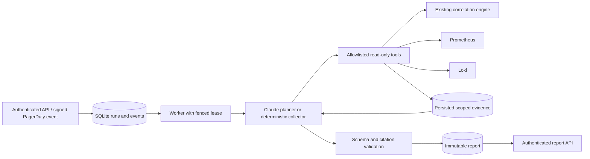
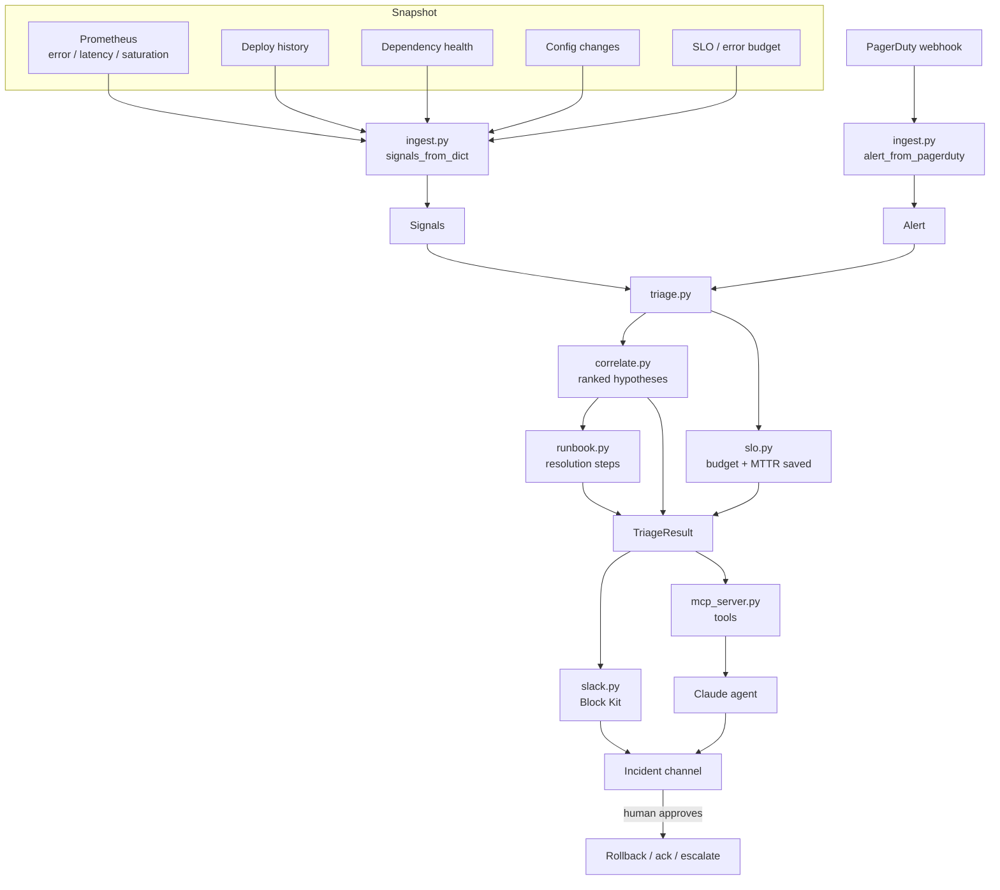

# Architecture

## Automation runtime

The new `incident_triage.automation` package surrounds the existing pure engine
with authenticated intake, a durable queue, bounded planning, and evidence storage.
See [automation setup and limitations](automation.md).

The model sees bounded, redacted evidence and proposes one next step. Application
code owns scope, budgets, persistence, and final status. Model interpretation can
still be incorrect; citation membership checks do not prove semantic support.
The snapshot engine supplies hypotheses, not established root causes.

SQLite itself is the durable job queue, so there is no database-to-broker dual
write. Intake inserts a run and its first progress event in one transaction.
Workers renew short leases and persist evidence after each tool call. Lease tokens
fence stale workers after cancellation or recovery. Model calls are reserved
before execution, so retries consume the same persistent per-run budgets.

## Original snapshot / MCP path

Layered so the **correlation logic** is pure and testable and the **agent
surface** (skill / MCP) is a thin adapter. An LLM never sees raw telemetry — it
calls typed tools that return a ranked, evidence-carrying RCA.

## Why this shape

**Correlation is separated from the agent.** `correlate.py`, `runbook.py`, and
`slo.py` have zero dependency on `mcp`, Slack, or any LLM. The judgment that
matters during an incident — which cause is most likely, which action to
propose — is deterministic and unit-tested. The agent orchestrates and
communicates; it does not invent the RCA.

**Recency and magnitude, not vibes.** Confidence is a bounded function of how
recently something changed and how large the anomaly is. That mirrors how a good
responder reasons and makes every score explainable.

**Propose, don't auto-remediate.** Destructive steps (rollback, drain) and
PagerDuty writes sit behind a human confirmation. Auto-remediation that's wrong
turns one incident into two — the whole value here is a faster *human* decision,
not an unsupervised one.

**Evidence travels with every hypothesis.** Because the output lands in an
incident channel and a post-mortem, each finding names the signal behind it.
"The model said so" is not an audit trail.
